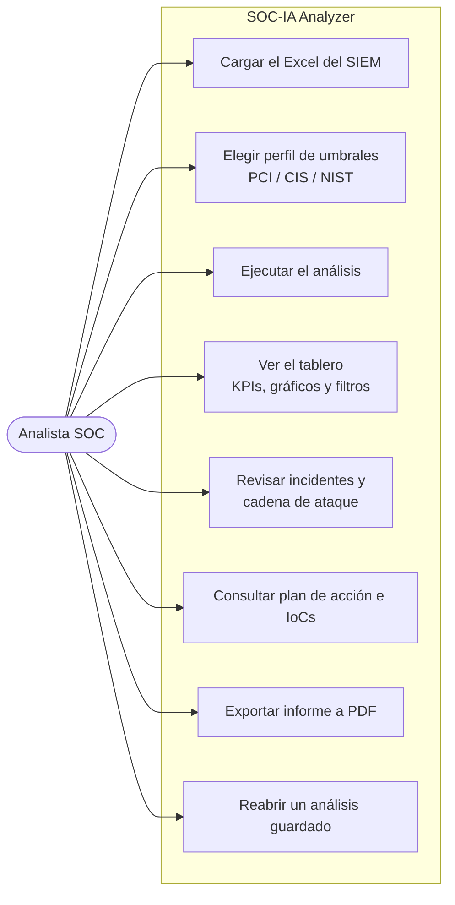
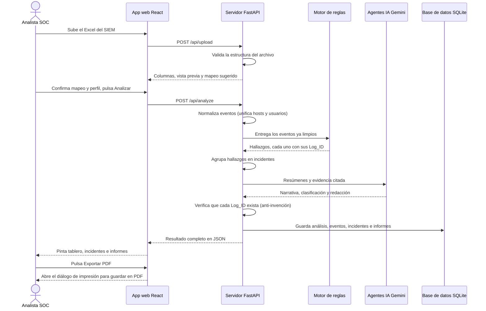
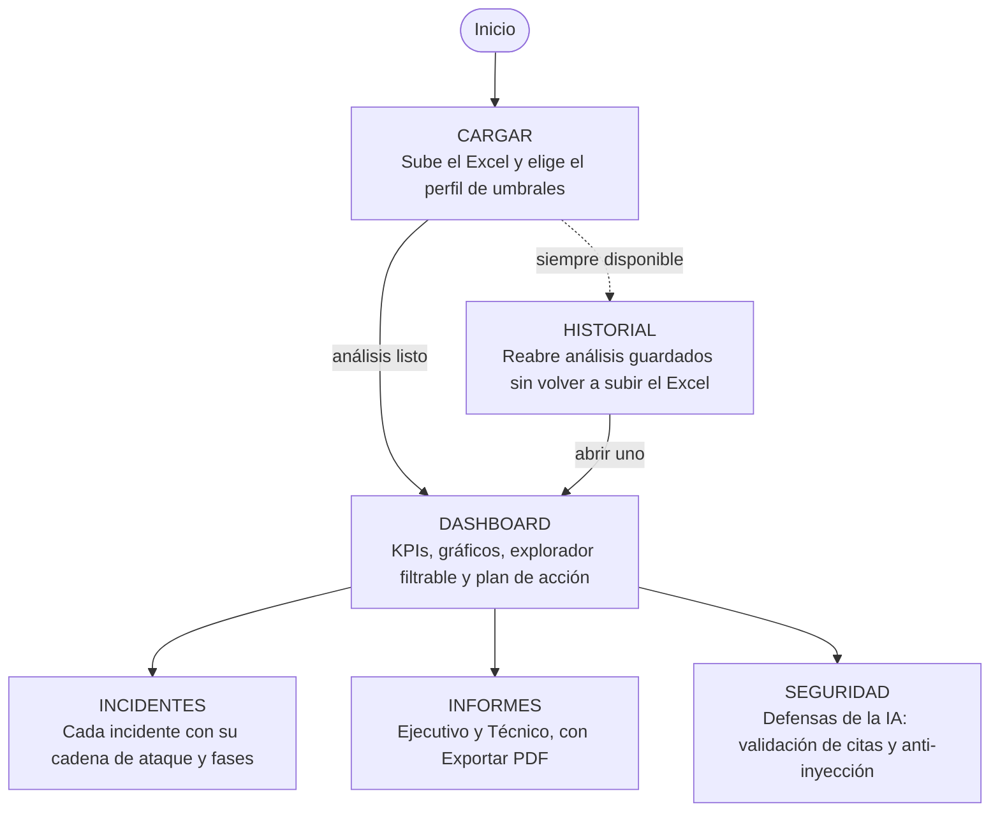
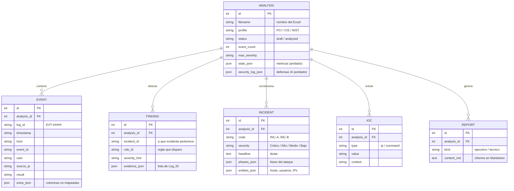

# Diagramas de arquitectura — SOC-IA Analyzer

Documentación visual de la plataforma, pensada para lectura de cliente: cada
elemento está etiquetado en lenguaje claro. Los diagramas están en Mermaid y
**se renderizan automáticamente en GitHub** (no hace falta ninguna herramienta
extra para verlos).

Contenido:
1. [Casos de uso — cómo interactúa el usuario](#1-casos-de-uso)
2. [Secuencia — cómo viaja la información](#2-secuencia-de-datos)
3. [Navegación — qué hace cada ventana](#3-navegación-de-ventanas)
4. [Base de datos — cómo se guarda todo](#4-modelo-de-base-de-datos)

---

## 1. Casos de uso

Qué puede hacer el analista con la aplicación. El muñeco es el usuario; cada
caja es una acción disponible.

---

## 2. Secuencia de datos

El viaje completo de la información, desde que el analista sube el archivo hasta
que descarga el PDF. Muestra cómo se comunican el navegador, el servidor, el
motor de reglas, la IA y la base de datos.

---

## 3. Navegación de ventanas

Las seis pestañas de la aplicación y qué hace cada una. Las pestañas de análisis
se desbloquean cuando hay un análisis cargado; el historial está siempre
disponible.

---

## 4. Modelo de base de datos

Cómo se guarda la información en SQLite. Un **análisis** es el centro: de él
cuelgan sus eventos, hallazgos, incidentes, indicadores e informes.

> **Nota de diseño (modelo híbrido):** las columnas marcadas como `json` guardan
> estructuras anidadas del análisis (métricas, fases, hitos, entidades). Es una
> decisión deliberada: las entidades principales están normalizadas en tablas,
> pero los resultados anidados del análisis se guardan como JSON para no
> fragmentar en decenas de tablas auxiliares. No es 3FN estricta en esas
> columnas; es el patrón habitual para payloads de análisis.

Se muestra un subconjunto representativo de columnas por legibilidad.

